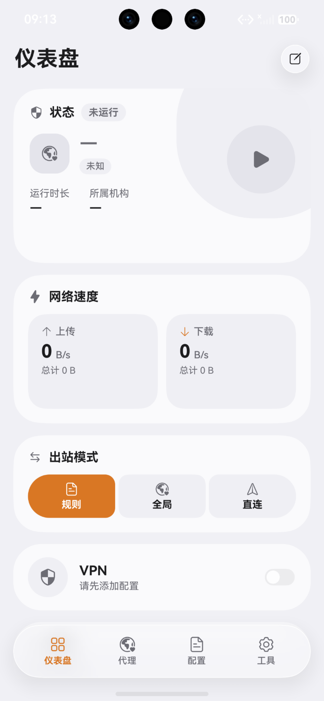
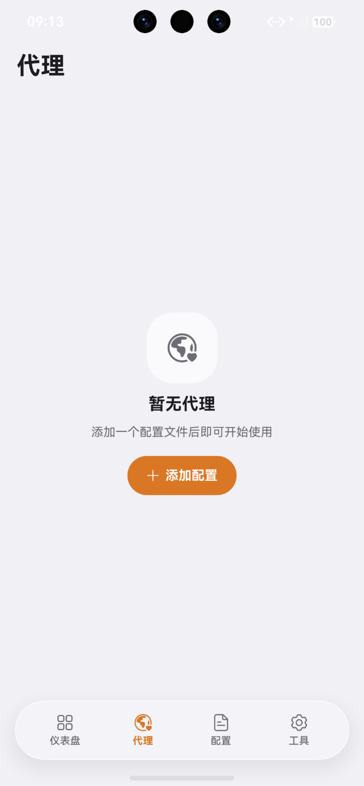
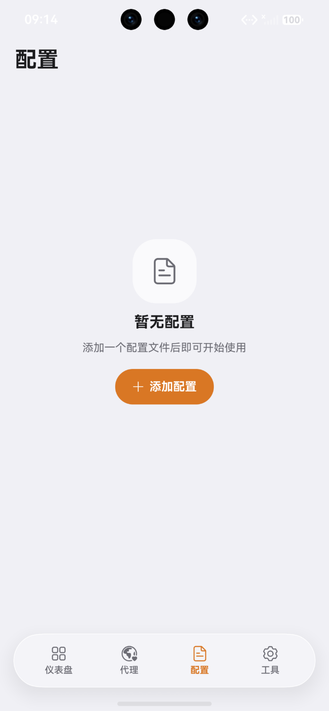
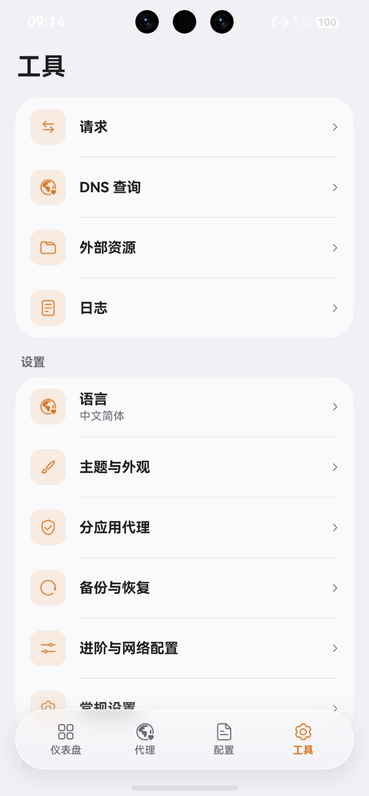

# LexiClash

面向 **HarmonyOS 7 及以上版本**的原生代理客户端，使用 ArkTS / ArkUI 构建界面，通过 C++ / N-API 桥接 Go 代理内核。

LexiClash 由我的另一个项目 **[OHClash](https://github.com/peryixing-lab/OHClash)** 迭代而来，继续完善配置管理和鸿蒙原生体验。项目参考了 **[FlClash](https://github.com/chen08209/FlClash)** 和 **[ClashMeta（mihomo）](https://github.com/MetaCubeX/mihomo)**，并使用、适配了 FlClash 的 Go 内核封装与其 Clash.Meta 分支源码，感谢这些开源项目及其贡献者。

> **本软件仅供参考与学习。** 项目采用 [GNU GPL v3.0](LICENSE) 开源协议，不提供任何形式的担保。项目不提供代理节点或订阅服务，使用者需自行准备配置。

## 项目截图

依次为仪表盘、代理、配置和工具页面，截图展示的是尚未添加配置时的状态。

<p align="center">
  
  
  
  
</p>

## 功能概览

- 仪表盘：运行状态、流量信息、规则 / 全局 / 直连模式切换。
- 配置管理：订阅导入与手动更新、粘贴 YAML、配置编辑及本地持久化。
- 代理管理：节点分组、搜索、排序、延迟测试、分享链接与手动节点导入。
- 链式代理：编辑节点顺序、预览配置并应用代理链。
- 鸿蒙原生 VPN Extension、TUN 接入和后台任务管理。
- TUN 与本地代理模式独立切换：关闭 TUN 后仍可连接本地 HTTP/SOCKS 代理；支持 System / gVisor / Mixed 协议栈、MTU 设置和应用后重连，见 [TUN 使用说明](docs/tun.md)。
- 分应用代理：按包名维护白名单 / 黑名单，支持保存设置与应用后重连；使用方式和平台限制见 [分应用代理说明](docs/app-routing.md)。
- WebRTC/STUN 防泄露、双栈 TUN 接管、代理 DNS 与 UDP 失败阻断；行为和真机验收步骤见 [网络隐私说明](docs/privacy.md)。
- 请求、DNS 查询、外部资源和日志页面，以及主题与外观设置。

当前为持续迭代的初始版本。部分页面与设置仍在完善，例如 WebDAV 备份尚未实现；不同设备、协议和网络环境的表现需要进一步验证。

## 下载

前往 **[Releases](https://github.com/peryixing-lab/LexiClash/releases)** 下载发布版本。

`v1.0.1` 提供 **ARM64 未签名 HAP** 和 `SHA256SUMS.txt`。未签名 HAP 需要使用自己的开发者证书和设备 Profile 签名后才能安装，也可以按下面的步骤从源码构建并运行。个人签名证书、密钥和设备调试配置不随仓库或 Release 提供。

## 分应用代理与包名获取

在「工具 → 分应用代理」中填写应用包名并勾选，再选择白名单或黑名单。白名单表示只有勾选的应用进入 VPN；黑名单表示勾选的应用直连，其余应用进入 VPN。分应用设置仅在 TUN 模式下生效。

获取应用包名的方法：

1. 打开需要设置分流的目标应用，在该应用内截一张图。
2. 在图库中找到这张截图，打开详情查看完整文件名；也可以在文件管理器中查看截图名称。
3. **截图文件名的最后一部分就是应用包名**，复制时去掉 `.png`、`.jpg` 等图片扩展名。例如，文件名以 `_com.example.app.png` 结尾时，填写 `com.example.app`。
4. 将包名填入 LexiClash 的「应用包名」，添加并勾选。VPN 正在运行时，点击「应用并重连」使设置生效。

请在目标应用的正常页面截图，避免使用桌面、系统弹窗或最近任务页面的截图。完整使用说明见 [分应用代理说明](docs/app-routing.md)。

## 1.0.1 更新

- 新增分应用代理，支持白名单、黑名单、按包名管理应用和本地保存。
- 完善 TUN 模式与本地代理模式切换，关闭 TUN 后仍可通过本地 HTTP/SOCKS 端口连接。
- 减少启动时的重复检查与等待，通知初始化不再阻塞连接成功状态。
- 修复连接中更换链式代理节点的问题，更新失败时恢复原配置，支持直接重试。
- 完善 IPv4/IPv6、代理 DNS、WebRTC/STUN 防泄露策略及相关说明。

## 从源码安装与运行

### 1. 克隆仓库

```sh
git clone https://github.com/peryixing-lab/LexiClash.git
cd LexiClash
```

仓库已包含所需的 Go 内核源码，无需额外初始化 Git 子模块。

### 2. 安装开发环境并注册开发者

1. 下载并安装 **不低于 DevEco Studio 26.0.0 Release** 的版本：**[华为官方下载安装入口](https://developer.huawei.com/consumer/cn/download/)**。在下载中心选择对应系统的安装包，并确认版本符合要求。
2. 可参考官方 [DevEco Studio 安装说明](https://developer.huawei.com/consumer/cn/doc/harmonyos-guides/ide-software-install) 和 [26.0.0 Release 版本说明](https://developer.huawei.com/consumer/en/doc/doccenter-release-notes/deveco-studio-new-features-2600/)。
3. 在 **[华为开发者联盟](https://developer.huawei.com/consumer/cn/)** 完成开发者注册和所需的实名认证，使用同一账号登录 DevEco Studio。
4. 安装项目需要的 **HarmonyOS SDK 26.0.0** 及 Native 工具链。当前目标 SDK 与最低兼容 SDK 均为 `26.0.0`，原生库架构为 `arm64-v8a`。

### 3. 检查随仓库提供的原生内核

仓库已一并提供 **Go 内核源码、ARM64 原生库及配套 C 头文件**：

- `entry/libs/arm64-v8a/libflclash_core.so`
- `entry/src/main/cpp/prebuilt/arm64-v8a/flclash_core.h`

正常克隆后即可使用 DevEco Studio 构建，无需先安装 Go 或手动编译内核。来源、SHA-256 校验值和构建方式见 [native/PREBUILT.md](native/PREBUILT.md)；需要修改内核时，可按 [Go 内核构建说明](docs/build-native.md) 重新生成。生成的其他构建产物仍由 `.gitignore` 排除。

### 4. 使用 DevEco Studio 加载与签名

1. 使用 DevEco Studio 打开克隆后的 **LexiClash 项目根目录**，等待项目同步和依赖安装完成。
2. 点击 **文件 → 项目结构 → 签名配置 → 自动生成签名文件**；英文界面对应 **File → Project Structure → Signing Configs → Automatically generate signing**。
3. 按提示登录开发者账号，为自己的调试设备生成签名文件并保存配置。

签名信息只应保留在本机。提交代码前，请移除 `build-profile.json5` 中自动生成的 `signingConfigs` 内容及个人签名关联，不要上传证书、密钥或密码。

### 5. 连接鸿蒙设备并运行

1. 准备一台系统版本 **不低于 HarmonyOS 7** 的 ARM64 设备。
2. 在设备中打开 **开发者模式**，启用 **USB 调试**。
3. 使用 USB 数据线连接电脑，在设备弹窗中允许电脑调试；若自动签名要求识别设备，可先连接再生成签名。
4. 在 DevEco Studio 选择已连接的设备，点击 **运行（Run）**，等待编译、签名、安装和启动完成。
5. 启动后添加自己的配置，使用 VPN 功能时按系统提示完成授权。

## 项目结构

- `entry/src/main/ets/`：ArkUI 页面、配置管理、内核控制与 VPN 生命周期。
- `entry/src/main/cpp/`：C++ / N-API 桥接。
- `native/core/`：Go 内核封装与 OpenHarmony 适配，含构建与第三方许可说明。
- `native/core/Clash.Meta/`：实际使用的 mihomo 分支源码。
- `native/build-core.sh`：ARM64 原生内核构建脚本。
- `docs/screenshots/`：项目截图。
- `scripts/`：本地验证与图标生成脚本。

## 开源协议与致谢

LexiClash 采用 **GNU General Public License v3.0（GPL-3.0）**，完整条款见 [LICENSE](LICENSE)。参考学习的用途说明不附加额外的许可限制；复制、修改和分发应遵守 GPL 及所使用第三方组件的许可证。

- **[OHClash](https://github.com/peryixing-lab/OHClash)**：由我开发的前序项目，LexiClash 在其基础上继续迭代。
- **[FlClash](https://github.com/chen08209/FlClash)**：参考其产品交互，并使用、适配其 Go 内核封装。
- **[ClashMeta / mihomo](https://github.com/MetaCubeX/mihomo)** 与 **[FlClash 的 Clash.Meta 分支](https://github.com/chen08209/Clash.Meta)**：代理内核与相关适配基础。
- **[OpenHarmony Go](https://gitcode.com/openharmony-sig/ohos_golang_go)**：OpenHarmony 平台 Go 工具链。

第三方来源、版本与许可说明见 [THIRD_PARTY_NOTICES.md](THIRD_PARTY_NOTICES.md)。原有版权及许可证声明保留在对应源码目录中。

## 后续计划

如果大家对其他平台版本的使用意愿较强，我会考虑推出 **Android 版、Windows 版和 macOS 版**。欢迎通过 [Issues](https://github.com/peryixing-lab/LexiClash/issues) 反馈需求。
